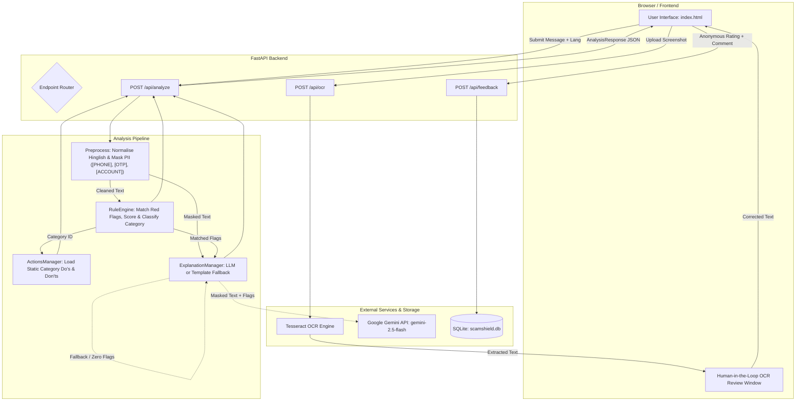

# ScamShield — System Audit & Baseline Report (Stage 0)

> **Date:** November 2026  
> **Environment:** Python 3.11.9, Windows PowerShell, FastAPI, SQLite  
> **Scope:** Full repository codebase inspection prior to upgrade (Stage 0 Audit Only).

---

## 1. Executive Summary & Baseline Metrics

ScamShield is an operational AI-assisted decision-support tool helping senior citizens in India detect and understand suspicious communications (SMS, WhatsApp, call transcripts). The existing code adheres to a strict separation of concerns: **a deterministic rule engine classifies risk, scores threats, and assigns red flags; Google Gemini (or pre-defined static templates) provides plain-language explanations; and static data files provide certified safety actions.**

### 1.1 Automated Test Suite Baseline (`pytest -q`)
Ran automated test suite via the bundled Python 3.11 runtime (`.\.python311\python.exe -m pytest -q`):
- **Total Tests:** 30 tests across 5 test modules
- **Passed:** 28 passed
- **Failed:** 2 failed
- **Execution Time:** ~7.35s
- **Failure Analysis:**
  - `tests/test_ocr.py::test_ocr_with_text_image` -> `AssertionError: assert False is True`
  - `tests/test_ocr.py::test_ocr_with_blank_image` -> `AssertionError: assert 'No text found' in 'Tesseract OCR engine is not configured. Please paste your message text directly.'`
  - **Root Cause:** Tesseract OCR binary (`tesseract.exe`) is not installed on the host system or not found on the default path (`C:\Program Files\Tesseract-OCR\tesseract.exe`). In `app/pipeline/ocr.py`, `pytesseract.TesseractNotFoundError` is caught gracefully and returns an informative error message for users, but `tests/test_ocr.py` asserts successful image processing without mocking or skipping when the binary is absent.
  - **Rule Compliance:** All 28 non-OCR tests passed completely (rules, Hinglish normalisation, PII masking, fallback templates, zero-flags behavior, database privacy).

### 1.2 Performance Evaluation Baseline (`evaluate.py`)
Ran `evaluate.py` across `data/sample_dataset.csv` (30 labelled messages, dev & test splits, scam vs genuine):

| Split | Total Samples | Scams | Genuine | Accuracy | Precision | Recall | F1-Score | Category Accuracy |
| :--- | :---: | :---: | :---: | :---: | :---: | :---: | :---: | :---: |
| **ALL** | 30 | 20 | 10 | **100.00%** | **100.00%** | **100.00%** | **100.00%** | **90.00% (18/20)** |
| **DEV** | 16 | 11 | 5 | **100.00%** | **100.00%** | **100.00%** | **100.00%** | **90.91% (10/11)** |
| **TEST** | 14 | 9 | 5 | **100.00%** | **100.00%** | **100.00%** | **100.00%** | **88.89% (8/9)** |

#### Confusion Matrix (Split: ALL):
```
                      Predicted Scam    Predicted Genuine
   Actual Scam       :     20                  0           (Total: 20)
   Actual Genuine    :      0                 10           (Total: 10)
```

#### Category Mismatches (2 items):
1. **ID 18 (Test Split):**
   - *Message:* `"Aapka beta police ki custody me hai accident ke baad. Case dabane ke liye turant 50,000 transfer kijiye aur kisi se mat kehna."`
   - *Actual Category:* `scam (family_emergency)`
   - *Predicted Category:* `scam (digital_arrest)` (Score: 11)
   - *Matched Flags:* `authority_impersonation`, `urgency_threat`, `secrecy_demand`, `immediate_payment`
2. **ID 20 (Dev Split):**
   - *Message:* `"Police station se inspector bol raha hu. Aapke bete ne accident kar diya hai. Mamla khatam karne ke liye turant paise bhejo."`
   - *Actual Category:* `scam (family_emergency)`
   - *Predicted Category:* `scam (digital_arrest)` (Score: 10)
   - *Matched Flags:* `authority_impersonation`, `urgency_threat`, `immediate_payment`, `family_emergency`

*Insight:* Both messages involve a police pretext in a family emergency context. Because `authority_impersonation` has weight 3 and links to `digital_arrest`, while `family_emergency` has weight 2, the scoring logic ranked `digital_arrest` higher. This will be tuned in Stage 3 without regressing precision/recall.

---

## 2. Architecture Summary & Request Flow

### 2.1 Modules Overview
- `app/main.py`: FastAPI server configuration, CORS middleware, API endpoint routing (`/api/analyze`, `/api/ocr`, `/api/feedback`, `/api/feedback/stats`), static files serving.
- `app/database.py`: SQLite connection handling, schema creation for anonymised `feedback` table, storage and aggregate stats querying.
- `app/schemas.py`: Pydantic models for request/response serialization and JSON configuration validation.
- `app/pipeline/preprocess.py`: Text sanitization, Hinglish normalisation (`normalize_text`), and regex-based sensitive PII masking (`mask_sensitive_data`).
- `app/pipeline/rules.py`: `RuleEngine` class for deterministic pattern compilation, scoring thresholds calculation, and category classification.
- `app/pipeline/ocr.py`: Screenshot image extraction wrapper using `PIL` and `pytesseract` (eng+hin).
- `app/pipeline/actions.py`: `ActionsManager` for retrieving verified static safety action checklists and official emergency contacts.
- `app/pipeline/explain.py`: `ExplanationManager` for generating plain-language explanations using Google Gemini (`gemini-2.5-flash`) with reliable fallback to `data/templates.json`.
- `static/`: Frontend interface consisting of vanilla HTML (`index.html`), CSS (`style.css`), bilingual dictionary (`i18n.js`), and controller (`app.js`).
- `data/`: JSON rule configurations (`red_flags.json`, `actions.json`, `templates.json`), sample dataset (`sample_dataset.csv`), and Tesseract language files (`tessdata/`).

### 2.2 System Request Flow Diagram



---

## 3. Current API Endpoints & Response Shapes

### 3.1 `GET /`
- **Purpose:** Serves the frontend single-page application.
- **Response:** `FileResponse` (`text/html`) serving `static/index.html`.

### 3.2 `POST /api/analyze`
- **Purpose:** Public endpoint executing the deterministic analysis and explanation pipeline.
- **Request Body (`AnalysisRequest`):**
  ```json
  {
    "text": "string (min_length=1)",
    "language": "en" | "hi"
  }
  ```
- **Response Body (`AnalysisResponse`):**
  ```json
  {
    "risk_level": "Low" | "Medium" | "High",
    "score": 11,
    "category": "digital_arrest",
    "category_name": "Digital Arrest Scam",
    "matched_flags": [
      {
        "id": "authority_impersonation",
        "name_en": "Authority Impersonation",
        "name_hi": "अधिकारी का झूठा दिखावा",
        "weight": 3,
        "snippets": ["cbi officer"]
      }
    ],
    "explanation": "This message displays clear indicators of a Digital Arrest fraud...",
    "explanation_source": "llm" | "template",
    "actions": {
      "dos": ["Disconnect the call immediately..."],
      "donts": ["Do NOT transfer any money..."],
      "official_channels": ["National Cyber Crime Helpline: 1930..."]
    },
    "language": "en",
    "masked_text": "main cbi officer bol raha hu... [ACCOUNT]"
  }
  ```
- **Status Codes:**
  - `200 OK`: Analysis successfully executed.
  - `400 Bad Request`: Message text is empty or whitespace-only.
  - `422 Unprocessable Entity`: Validation failure on input shape or language.

### 3.3 `POST /api/ocr`
- **Purpose:** Human-in-the-loop OCR screenshot extraction.
- **Request:** `multipart/form-data` with `file: UploadFile`.
- **Response Body (`OCRResponse`):**
  ```json
  {
    "extracted_text": "string",
    "success": true,
    "message": "string"
  }
  ```
- **Status Codes:** `200 OK` (with `success: false` and user-friendly error message on OCR failure/unsupported file).

### 3.4 `POST /api/feedback`
- **Purpose:** Submits anonymous user feedback on detection helpfulness.
- **Request Body (`FeedbackRequest`):**
  ```json
  {
    "helpful": true,
    "category": "digital_arrest",
    "risk_level": "High",
    "comment": "Optional senior citizen user remarks"
  }
  ```
- **Response Body:** `{"status": "ok", "message": "Feedback submitted successfully.", "id": 1}`.
- **Status Codes:** `200 OK`, `500 Internal Server Error`.

### 3.5 `GET /api/feedback/stats`
- **Purpose:** Aggregate statistics for feedback.
- **Response Body:**
  ```json
  {
    "total_feedback": 10,
    "helpful_count": 8,
    "unhelpful_count": 2,
    "satisfaction_rate": 80.0
  }
  ```

---

## 4. Current Database Schema

The database is an unversioned SQLite database located at `data/scamshield.db`.

```sql
CREATE TABLE IF NOT EXISTS feedback (
    id INTEGER PRIMARY KEY AUTOINCREMENT,
    timestamp TEXT NOT NULL,
    category TEXT,
    risk_level TEXT,
    helpful INTEGER NOT NULL,
    comment TEXT
);
```

### Observations:
- **No Schema Versioning:** `PRAGMA user_version` is `0`. There is no migration tracking system.
- **No Foreign Keys / WAL Mode:** Database connection does not enforce `PRAGMA foreign_keys = ON` or `PRAGMA journal_mode = WAL`.
- **Privacy Compliance:** Confirmed that `feedback` stores strictly anonymous fields. Neither raw messages, masked text, phone numbers, nor user identity columns exist.
- **Missing Tables for Auth & User History:** There are currently no tables for users, sessions, analyses, preferences, or password resets.

---

## 5. Existing Bugs & Functional Flaws

1. **OCR Tests fail when Tesseract binary is absent on Host OS:**
   - In `tests/test_ocr.py`, tests run directly against `extract_text_from_image` without checking if the local engine binary is configured or mocking pytesseract.
2. **Category Disambiguation Collision between Family Emergency and Digital Arrest:**
   - In `evaluate.py`, 2 out of 20 scam samples (IDs 18 and 20) are classified as `digital_arrest` instead of `family_emergency` because impersonating police (`authority_impersonation`, weight 3) outranks family emergency keywords (`family_emergency`, weight 2).
3. **OCR Cancel Clears Message Input:**
   - In `static/js/app.js:handleClearInput()`, cancelling OCR can clear user input unexpectedly.
4. **Hardcoded Model Version in Gemini Integration:**
   - `app/pipeline/explain.py` hardcodes `gemini-2.5-flash`. If Google changes model availability, this should be configurable via environment variables (`GEMINI_MODEL`).

---

## 6. Security Gaps

1. **Permissive CORS Configuration:**
   - In `app/main.py`:
     ```python
     app.add_middleware(
         CORSMiddleware,
         allow_origins=["*"],
         allow_credentials=True,
         allow_methods=["*"],
         allow_headers=["*"],
     )
     ```
   - Allowing wildcard origins `"*"` alongside `allow_credentials=True` violates browser security standards when credentials (cookies) are used and permits cross-origin abuse.
2. **Missing Rate Limiting:**
   - No rate limiting is implemented on `/api/analyze`, `/api/ocr`, or `/api/feedback`. The server is susceptible to request floods and Gemini API quota exhaustion.
3. **Unvalidated Upload Size & MIME Type on OCR:**
   - `ocr_screenshot` relies solely on `file.content_type.startswith("image/")` from client request headers (easily manipulated) and performs unbounded `await file.read()` in memory without file size caps (DOS risk).
4. **Lack of HTTP Security Headers:**
   - No `Content-Security-Policy`, `X-Content-Type-Options: nosniff`, `X-Frame-Options: DENY`, or `Referrer-Policy: strict-origin-when-cross-origin` headers are emitted.
5. **Absence of Authentication & Access Controls:**
   - No user identity, JWT, session revocation, or role checking currently exists.

---

## 7. Privacy Gaps & Data Handling Audit

- **Raw Text Persistence:** Verified zero instances of raw message, transcript, or screenshot storage in `app/database.py` or filesystem.
- **Masking Integrity:** `app/pipeline/preprocess.py` masks cards, bank accounts, UPI IDs, PAN, Aadhaar, OTPs, and phone numbers before any LLM invocation.
- **LLM Privacy Boundary:** Only `masked_text`, `category_name`, and `matched_flags` are sent to Google Gemini in `app/pipeline/explain.py`.
- **Zero-Flag LLM Protection:** Messages with zero detected red flags never trigger an LLM API call; they immediately return the static template from `data/templates.json`.
- **Potential Logging Risk:** In `app/pipeline/explain.py:120`, logger warning logs exception string `logger.warning(f"Gemini API call failed...: {e}")`. If an SDK exception mirrors request content, masked text or metadata might leak into server log files. All loggers should be audited in Stage 1/Stage 8 to ensure zero PII leakage.

---

## 8. Platform Limitations & Boundary Conditions

1. **Web Sandbox Constraints:**
   - Standard web browsers cannot automatically intercept, inspect, or read incoming SMS or WhatsApp notifications. Supported message ingest methods for web are strictly:
     - Direct text copy-paste
     - Screenshot image upload
     - Android Web Share Target (via PWA manifest)
   - iOS Safari does not support the Web Share Target API for receiving files or text from other apps.
2. **OCR Engine Requirement:**
   - Tesseract OCR requires native binary installation on the host machine (`UB-Mannheim.TesseractOCR` on Windows or `tesseract-ocr` on Linux) along with trained language models (`eng`, `hin`). When missing, the app gracefully degrades by prompting user to paste text.
3. **In-Memory Volatility:**
   - Temporary share-target data or in-flight rate limit counters must operate with proper TTLs without leaking memory.

---

## 9. Non-Negotiable Behaviors to Preserve

1. **Deterministic Rule Supremacy:** Red flags, categories, risk scores, and risk levels are decided exclusively by `app/pipeline/rules.py` and `data/red_flags.json`.
2. **LLM Boundary:** Google Gemini only crafts plain-language explanations from masked text. If unavailable, pre-defined templates are used. Gemini never generates scores, categories, or safety actions.
3. **Static Safety Actions:** Safety guidance and helpline numbers come exclusively from `data/actions.json`.
4. **Zero-Flag Invariant:** Harmless messages must be labelled `"No known red flag found – stay cautious"` (Low risk). **Never label any message "Safe" or "Genuine".**
5. **PII Masking Pre-flight:** Phone numbers, OTPs, account numbers, UPI IDs, and cards must be masked before any text leaves the server or is logged.
6. **Zero Raw Text Persistence:** Never store raw messages, screenshots, OCR text, OTPs, or phone numbers in the database.
7. **Human-in-the-Loop OCR:** OCR review and text correction window must remain available for users before running analysis.
8. **Bilingual Support:** Complete English and Hindi parity across all UI text, red flags, explanations, and safety actions.
9. **Guest Analysis Availability:** The quick scan `/api/analyze` must remain 100% accessible to unauthenticated guests without requiring registration or saving records.
10. **Accessibility First:** Senior-friendly UI with high contrast, large touch targets, clear typography, and multi-factor risk badges (color + text + icon).

---

## 10. Implementation Checklist for Stages 1–8 (Adjusted)

| Stage | Focus Area | Key Deliverables & Strategy | Potential Conflicts & Mitigations |
| :--- | :--- | :--- | :--- |
| **Stage 1** | Auth Backend & Safe DB Migrations | • DB versioning via `PRAGMA user_version` & idempotent runner in `app/migrations/`<br>• Tables: `users`, `sessions`, `analyses`, `preferences`, `password_resets`<br>• Password hashing with Argon2id (`argon2-cffi`)<br>• JWT authentication (`PyJWT`, HS256) via HttpOnly, SameSite cookie + CSRF check<br>• Endpoints: register, login, logout, me, forgot/reset password<br>• In-memory rate limiting module (429 with Retry-After)<br>• Keep `/api/analyze` public for guest use | • *Conflict:* Database schema currently has no versioning. *Mitigation:* Migration step 001 safely backs up `scamshield.db` to `data/backups/`, enables WAL + foreign keys, and alters/creates tables without touching legacy feedback data. |
| **Stage 2** | History, Stats, Reports & Privacy API | • Save anonymised metadata on analysis for logged-in users only<br>• Endpoints: `GET/DELETE /api/history`, `GET /api/stats/overview`, `GET /api/stats/reports`, `GET /api/reports/export`<br>• Privacy preference: `retain_masked_text` (boolean, default false)<br>• SQL aggregates only; zero hardcoded numbers | • *Conflict:* Guest users must never pollute user history. *Mitigation:* `get_current_user_optional` dependency in FastAPI; if user is None, skip saving analysis. |
| **Stage 3** | Detection Engine Expansion (JSON-First) | • Add 4 categories: Investment/Trading Fraud, Suspicious UPI Request, Fake Bank / Phishing Link, Impersonation of Government Officer<br>• Multilingual patterns and weights in `data/red_flags.json`<br>• Category actions in `data/actions.json` and templates in `data/templates.json`<br>• Add test messages to `sample_dataset.csv` and unit tests<br>• Resolve `family_emergency` vs `digital_arrest` mismatch | • *Conflict:* Adding new flags risks false positives or category drift. *Mitigation:* Run `evaluate.py` continuously; refine pretext keywords and patterns to ensure precision and recall stay at 100%. |
| **Stage 4** | Design System, App Shell, Auth Pages | • CSS design tokens (`static/css/tokens.css`) & component library (`static/css/components.css`)<br>• Modern cybersecurity SaaS aesthetic (Inter + Noto Sans Devanagari fallback)<br>• Large text mode toggle (20px+ font)<br>• Auth pages: Login, Signup, Forgot Password, Reset Password, Profile<br>• Hash-based client router; responsive sidebar and mobile drawer | • *Conflict:* Keep existing public scan functional. *Mitigation:* The public scan page remains the default route (`#/scan` or `/`), styled with new tokens. |
| **Stage 5** | Dashboard, Scan Page, Result View | • Overview dashboard with Chart.js 4.x (locally vendored in `static/vendor/`)<br>• Rotating verified security tips from static JSON (RBI/I4C/CERT-In advice)<br>• Unified Senior-friendly Result View component (8 standard elements)<br>• Scan page with paste box, screenshot upload, and sticky mobile analyze button | • *Conflict:* External CDN dependencies. *Mitigation:* Vendor Chart.js 4.x locally with no external script tags. |
| **Stage 6** | History, Reports, Settings Pages | • History page with filters (risk, category, date), search, pagination, drawer detail<br>• Reports page with activity charts and anonymised CSV/JSON export<br>• Settings page with language switch, large text mode, privacy toggle, clear history, delete account | • *Conflict:* Search over historical scans when raw text is not saved. *Mitigation:* Search query matches category names and matched flag labels only. |
| **Stage 7** | Mobile Detection (Web-Feasible Part) | • PWA manifest (`manifest.webmanifest`) with Web Share Target (`POST /share-target`)<br>• Multi-screenshot upload (up to 5 images, 5MB each, validated magic bytes)<br>• In-memory 5-minute single-use store for shared content<br>• Platform guidance page (WhatsApp, SMS, Telegram, iPhone limitations)<br>• Write `docs/ANDROID_INTEGRATION_PLAN.md` & `docs/MOBILE_TEST_CHECKLIST.md` | • *Conflict:* iOS Safari does not support Web Share Target. *Mitigation:* Document clearly in UI and checklist that iOS uses copy-paste/upload. |
| **Stage 8** | Responsive QA, Security Hardening, Docs | • Multi-viewport responsive QA (360px to 1440px) using browser tool<br>• Security headers, strict CORS from env, rate-limiting on analysis & uploads<br>• Log sanitization verification test (fake phone/OTP never in logs or DB)<br>• Comprehensive documentation updates in `README.md` and `.env.example` | • *Mitigation:* Run complete test suite and verify full compliance with non-negotiable rules. |

---

## 11. Conclusion
The current ScamShield codebase possesses a solid, privacy-compliant architectural core. The deterministic rule engine and preprocessing pipeline strictly isolate sensitive information and decouple classification from generative AI. The planned 8 stages will incrementally introduce authentication, historical analytics, expanded fraud coverage, accessible modern UI, and mobile sharing capabilities while upholding all non-negotiable product and security rules.
